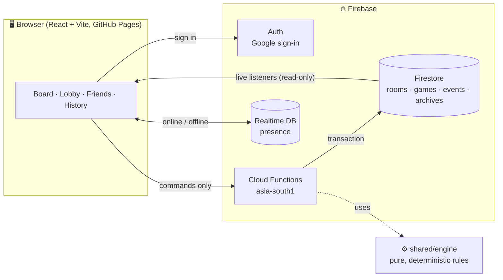
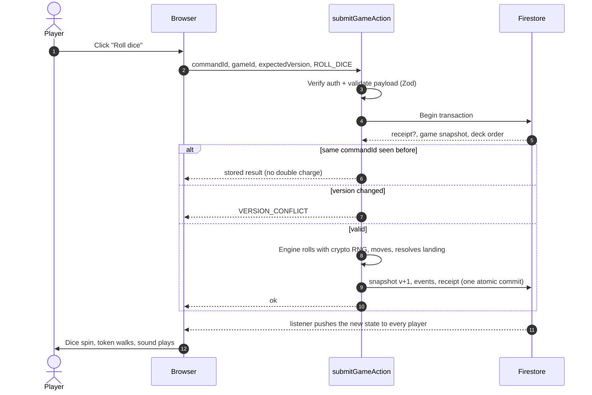
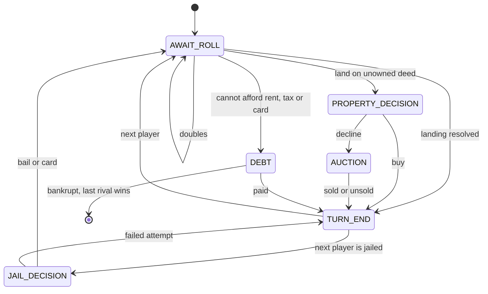

<div align="center">


# Indian Business Tycoon

### Buy Cities · Build Empires · Bankrupt Your Friends

A real-time multiplayer Indian property-trading board game for **2–6 friends**, playable in any browser.

[](https://github.com/blessingstonsk/Indian-Business-Tycoon-/actions/workflows/ci.yml)


[**Features**](#-features) · [**Screenshots**](#-screenshots) · [**How to play**](#-how-to-play) · [**Quick start**](#-quick-start) · [**Architecture**](#%EF%B8%8F-architecture) · [**Deploy**](#-deployment) · [**Roadmap**](#%EF%B8%8F-roadmap)

<br />

<picture>
  <source media="(prefers-color-scheme: dark)" srcset="docs/images/board-dark.png" />
  <source media="(prefers-color-scheme: light)" srcset="docs/images/board-light.png" />
  
</picture>

<sub>The hero image follows your GitHub light/dark theme. Try switching it.</sub>

</div>

---

## ✨ Features

<table>
<tr>
<td width="33%" valign="top">

### 🎲 Fair, server-side play
Dice, rent, auctions, bankruptcy and the winner are all decided by **trusted backend code**. The browser only asks for actions. Every move is versioned and idempotent, so double clicks and flaky mobile networks never charge you twice.

</td>
<td width="33%" valign="top">

### 🏙️ An original Indian board
40 spaces with **22 cities** from Jaipur to Mumbai, **4 transit lines** (Mumbai Local, Delhi Metro, Kolkata Tram, Vande Bharat), 2 utilities, GST Checkpost, and Fortune & Civic Chest cards.

</td>
<td width="33%" valign="top">

### 👥 Friends & private rooms
Google sign-in, friend codes, friend requests, and room invites. Share a six-character code or link, pick a token 🐘 🛺 🐅 🦚 🪷 🏏, and start when everyone is ready.

</td>
</tr>
<tr>
<td valign="top">

### 🏗️ Full rulebook
Buy or auction, even building (4 blocks → tower), mortgages, jail with doubles and bail, three-doubles rule, a debt and liquidation flow, and atomic trades of cash, deeds and jail cards.

</td>
<td valign="top">

### ✨ Delightful, but calm
3D dice, step-by-step token movement, card flips, confetti, synthesized sound effects, and light/dark themes. **Reduced motion** and **mute** are respected everywhere.

</td>
<td valign="top">

### 🗄️ History that's kept, clutter that isn't
Finished games are archived with standings and key moments. Live data is removed only **after the archive is verified**. Reactions vanish after 8 seconds.

</td>
</tr>
</table>

> [!NOTE]
> **Virtual money only.** There are no payments, betting, prizes or cash-out. The game uses its own name, board, card text and artwork, and is not affiliated with any commercial board-game brand.

## 📸 Screenshots

<table>
<tr>
<td width="50%"><p align="center"><sub><b>Landing</b>: dark mode</sub></p></td>
<td width="50%"><p align="center"><sub><b>Landing</b>: light mode</sub></p></td>
</tr>
<tr>
<td><p align="center"><sub><b>Lobby</b>: room code, tokens, host settings</sub></p></td>
<td><p align="center"><sub><b>Deed card</b>: rents for each upgrade level</sub></p></td>
</tr>
</table>

<details>
<summary><b>📱 See it on a phone</b></summary>
<br />
<p align="center"></p>
<p align="center"><sub>The board fits the screen width, with a compact player strip, a sticky action panel, and zoom & pan.</sub></p>
</details>

## 🎮 How to play

| | |
|---|---|
| 💰 **Start** | Everyone begins with **₹15,000**. Pass or land on START to collect **₹2,000**. |
| 🎲 **Roll** | Move clockwise. Doubles roll again, but **three doubles** in a row sends you to Jail. |
| 🏠 **Buy** | Land on an unowned city, transit line or utility to buy it. Decline it and **everyone bids** in an auction. |
| 🧾 **Rent** | A full colour group doubles base rent. Transit rent grows with every line you own; utilities multiply the dice. |
| 🏗️ **Build** | Own a whole group, then add blocks evenly (up to 4), then a **tower**. Rent climbs steeply. |
| 🏦 **Raise cash** | Sell buildings for half, mortgage deeds for half the price, or trade. |
| 🔒 **Jail** | Pay ₹500 bail, use a Get Out of Jail Free card, or try for doubles (3 tries). |
| 🏆 **Win** | Be the last solvent tycoon, or have the highest net worth when the 90-minute **Timed** mode ends. |

<details>
<summary><b>🗺️ The full board (all 40 spaces)</b></summary>
<br />

| Group | Spaces | Price range |
|---|---|---|
| 🟫 Terracotta | Jaipur – MI Road, Jodhpur – Clock Tower | ₹600 |
| 🟦 Sky | Patna – Golghar, Bhopal – Upper Lake, Lucknow – Hazratganj | ₹1,000–1,200 |
| 🩷 Rose | Varanasi – Dashashwamedh Ghat, Coimbatore – Race Course, Visakhapatnam – RK Beach | ₹1,400–1,600 |
| 🟧 Saffron | Indore – Rajwada, Nagpur – Zero Mile, Chandigarh – Sector 17 | ₹1,800–2,000 |
| 🟥 Crimson | Kochi – Fort Kochi, Surat – Diamond Market, Ahmedabad – Sabarmati Riverfront | ₹2,200–2,400 |
| 🟨 Turmeric | Pune – Shaniwar Wada, Goa – Panaji, Kolkata – Howrah Bridge | ₹2,600–2,800 |
| 🟩 Emerald | Hyderabad – Charminar, Chennai – Marina Beach, Bengaluru – MG Road | ₹3,000–3,200 |
| 🟪 Indigo | Delhi – Connaught Place, Mumbai – Marine Drive | ₹3,500–4,000 |
| 🚆 Transit | Mumbai Local, Delhi Metro, Kolkata Tram, Vande Bharat Express | ₹2,000 |
| ⚡ Utilities | Power Grid, Jal Board | ₹1,500 |
| 🎴 Cards | 3 × Fortune, 3 × Civic Chest (16 cards each) | — |
| 🏛️ Taxes | GST Checkpost ₹2,000 · Infrastructure Levy ₹1,000 | — |
| ⬛ Corners | START · Jail / Just Visiting · Rest House · Go To Jail | — |

Every price, rent, card and amount lives in versioned config: [`shared/board-config.ts`](shared/board-config.ts), [`shared/cards.ts`](shared/cards.ts) and [`shared/ruleset.ts`](shared/ruleset.ts). The full rules are in [`docs/rules.md`](docs/rules.md).

</details>

<details>
<summary><b>💬 Reactions & quick phrases</b></summary>
<br />

There's no free-text chat. Players react with a curated set, rate-limited to 3 every 5 seconds:

👏 😂 😮 😭 😤 😎 🙏 🔥 💰 ☕ · 🧾 *Pay my rent!* · 🤝 *Let's trade!* · ⏰ *Your turn!* · 🏆 *Good game!* · 🍀 *Best of luck!* · ⏳ *One minute…*

</details>

## 🚀 Quick start

<details open>
<summary><b>Option A: full multiplayer locally with the Firebase emulators (recommended)</b></summary>
<br />

**You need:** Node 22 (see `.nvmrc`) and Java 11+. On Windows: `winget install EclipseAdoptium.Temurin.21.JDK`. The Firebase CLI comes with the dev dependencies.

**1. Install**

```bash
npm install
```

```bash
npm install --prefix functions
```

**2. Create `.env.local`.** `demo-*` projects never touch real Firebase.

```ini
VITE_FIREBASE_API_KEY=demo-api-key
VITE_FIREBASE_AUTH_DOMAIN=demo-ibt.firebaseapp.com
VITE_FIREBASE_PROJECT_ID=demo-ibt
VITE_FIREBASE_APP_ID=1:000000000000:web:demo
VITE_FIREBASE_DATABASE_URL=https://demo-ibt-default-rtdb.firebaseio.com
VITE_USE_EMULATORS=true
```

**3. Start the backend** (builds the functions, then starts Auth, Firestore, Functions and Realtime Database):

```bash
npm run emulators
```

**4. Start the app** in a second terminal:

```bash
npm run dev
```

**5. Play.** Open <http://localhost:5173> and type a name into **Test sign-in**. Open a **second tab** and sign in with another name to get a second player, since each tab has its own session. Typing the same name again returns you to the same seat. The emulator dashboard is at <http://127.0.0.1:4000>.

> [!TIP]
> **Windows:** if the Firestore emulator exits with `Unable to establish loopback connection`, create `C:\jtmp` and set
> `JAVA_TOOL_OPTIONS=-Djdk.net.unixdomain.tmpdir=C:/jtmp` before running `npm run emulators`.

</details>

<details>
<summary><b>Option B: just look at the board (no backend)</b></summary>
<br />

```bash
npm run dev
```

Then open <http://localhost:5173/#/dev/playground>. This development-only page runs the real rules engine in your browser, hot-seat style; use **View as** to switch players. It's not multiplayer, and it isn't included in production builds.

</details>

<details>
<summary><b>Option C: a real Firebase project</b></summary>
<br />

Create a project, enable **Google sign-in**, **Firestore** (`asia-south1`) and the **Realtime Database**, copy its web config into `.env.local` with `VITE_USE_EMULATORS=false`, then deploy the backend (see [Deployment](#-deployment)).

</details>

<details>
<summary><b>🧰 All scripts</b></summary>
<br />

| Command | What it does |
|---|---|
| `npm run dev` | Vite dev server on :5173 |
| `npm run emulators` | Build functions + start the Firebase Emulator Suite (`demo-ibt`) |
| `npm test` | Engine unit & property tests + backend integration tests |
| `npm run test:rules` | Firestore security-rules tests on the emulator |
| `npm run test:e2e` | Playwright (run `npx playwright install chromium` once) |
| `npm run typecheck` | App, shared engine and functions |
| `npm run lint` | ESLint |
| `npm run build` | Production build into `dist/` |
| `npm run functions:build` | Bundle Cloud Functions into `functions/lib` |
| `node scripts/readme-screenshots.mjs` | Regenerate the images in this README |

</details>

## 🏛️ Architecture



<details>
<summary><b>🔁 What happens when you click “Roll dice”</b></summary>
<br />



</details>

<details>
<summary><b>🧭 Turn state machine</b></summary>
<br />



When a turn timer expires, the server applies a deterministic default (auto-roll, decline, close the auction, auto-liquidate, or end the turn), so an offline player can never stall a game.

</details>

<details>
<summary><b>🔐 Security model</b></summary>
<br />

- **Clients never write.** [`firestore.rules`](firestore.rules) denies every client write. All changes go through Cloud Functions.
- **Hidden information stays hidden.** Card deck order lives in a server-only document.
- **One command = one transaction.** Each command checks the version, applies the engine, appends events and stores an idempotency receipt atomically.
- **Membership everywhere.** Only room members can read rooms, games and events, and only participants can read an archive.
- **Abuse limits.** Rate limits cover room creation, joins, friend requests and reactions. Invite codes are hashed and use an unambiguous alphabet.
- **Privacy.** Logs carry hashed IDs and correlation IDs, never tokens. Other players see only your display name, photo and friend code.

</details>

<details>
<summary><b>📁 Project structure</b></summary>
<br />

```text
shared/              Pure domain: board, cards, ruleset, engine, Zod schemas, API errors
  engine/            Deterministic state machine (RNG, clock, IDs injected)
  test/              Unit + fast-check property tests
functions/src/       Cloud Functions
  room-service/      Rooms, lobby, reactions, invites
  game-engine/       submitGameAction + timeout sweeper
  friend-service/    Profiles, friends, archives, account deletion
  archive-service/   Archive → verify → cleanup
  db/                Firestore adapter + in-memory adapter for tests
src/                 React app (features/, components/, hooks/, stores/)
tests/rules/         Security-rules tests (emulator)
e2e/                 Playwright
docs/                architecture · rules · runbooks · images
```

More detail: [`docs/architecture.md`](docs/architecture.md) · [`docs/rules.md`](docs/rules.md) · [`docs/runbooks.md`](docs/runbooks.md)

</details>

## 🧪 Testing

| Suite | What it proves | Count |
|---|---|---|
| Engine unit tests | movement, rent, doubles, jail, auctions, cards, building, trades, bankruptcy, timed mode | 39 |
| Property-based invariants | money is conserved, building stays even, bank stock adds up, jail cards accounted for, version always increases | 2 × 150 runs |
| Backend integration | full rooms, duplicate joins, out-of-turn moves, replays, simultaneous bids, rate limits, archive-before-delete | 20 |
| Security rules (emulator) | non-members locked out, no client writes, deck order hidden | 4 |

## 🌍 Deployment

<details>
<summary><b>Step-by-step (Firebase + GitHub Pages)</b></summary>
<br />

1. Create separate **staging** and **production** Firebase projects (Blaze plan for Functions and schedules) and set **budget alerts**.
2. Enable **Google** sign-in, and add your Pages or custom domain to *Auth → Authorized domains*.
3. Create Firestore in `asia-south1` and the Realtime Database in `asia-southeast1`.
4. Deploy the backend:
   ```bash
   npx firebase deploy --project staging --only firestore,database,functions
   ```
5. Enable the **TTL policies** on `ttlAt` (reactions, rate limits, command receipts).
6. Set up **App Check** (reCAPTCHA Enterprise): set `VITE_APPCHECK_SITE_KEY`, and `ENFORCE_APP_CHECK=true` for functions.
7. In GitHub, go to **Settings → Pages → Source: GitHub Actions**, then add the repository variables `VITE_FIREBASE_*` (and optionally `VITE_APP_BASE_PATH`). Every push to `main` deploys.

> [!IMPORTANT]
> Never commit service-account keys. The Firebase web config is public by design; security comes from Auth, the rules, App Check and the backend checks.

</details>

## 🗺️ Roadmap

- [x] Pure rules engine with property-based tests
- [x] Server-authoritative commands, idempotency and version checks
- [x] Rooms, ready-up, invite codes and links, host hand-over
- [x] Friends, friend codes, room invites, privacy settings
- [x] Reactions with rate limits and auto-expiry
- [x] Archive → verify → cleanup lifecycle, game history
- [x] Responsive board, 3D dice, animations, sound, dark mode
- [ ] Real Firebase project, App Check and budget alerts
- [ ] Two-device and six-player playtests on mobile Safari and Android
- [ ] Balance simulations for tower rents
- [ ] Bots for solo practice

<div align="center">
<br />
<sub>Made with ☕ and 🎲 · Have fun, and pay your rent on time.</sub>
</div>
